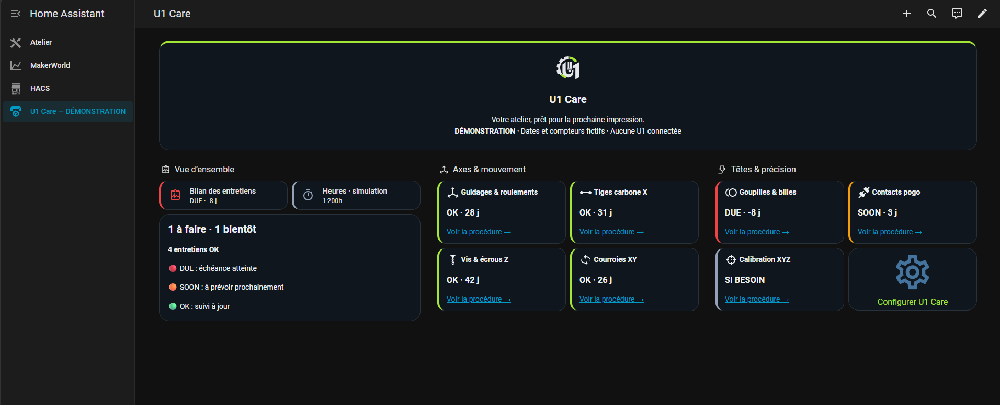
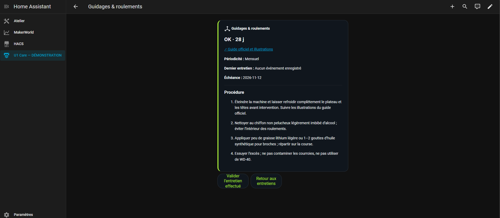
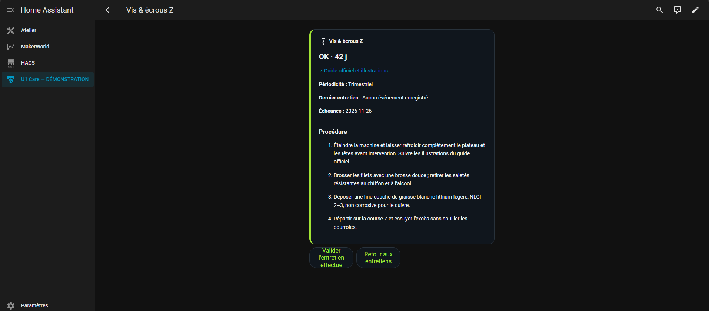
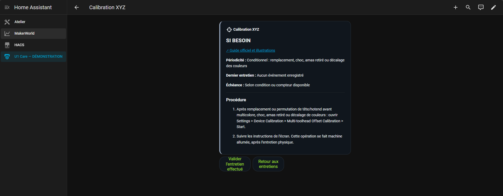

# U1 Care

**Snapmaker U1 maintenance tracking for Home Assistant and Stream Deck.**

U1 Care keeps your maintenance schedule, procedures and service history in one place. Available maintenance intervals come from Snapmaker’s documentation, so you don’t have to enter each one yourself.

Every task has its own completion date and next due date. Recording belt maintenance, for example, leaves the guides and toolhead contacts on their own schedules.

## Home Assistant

**Version 0.4.0** reads the real change counters of all four toolheads using the working U1Deck protocol. The cumulative pogo sensor preserves existing maintenance references and detects firmware counter resets. Setup asks for a custom name and offers a commissioning date, with no demo option. [Release notes and HACS update](docs/RELEASE-0.4.0.md).

Adding your U1 automatically creates a dashboard in the sidebar. It shows the remaining days or cycles, maintenance status and links to each procedure.

- **OK** — up to date.
- **SOON** — maintenance is coming up.
- **DUE** — the deadline has been reached or passed.
- **UNKNOWN** — a date or counter is missing.
- **AS NEEDED** — maintenance depends on a specific condition.

The cards stay compact. Each procedure link opens the instructions, the official reference and a button to record the completed task. Only that task is updated, and its record is kept when Home Assistant restarts.

You can customize the dashboard using Home Assistant’s built-in editor. U1 Care updates preserve those changes. [More about the dashboard](DASHBOARD.md).

*Screenshots show the French interface in demo mode, with sample dates and counters.*

View sample maintenance pages

### Linear shafts and bearings

### Z lead screws and nuts

### XYZ calibration

### Install with HACS

**Requires Home Assistant 2026.8.2 or later.**

1. Open the HACS link, add the custom repository and download **U1 Care**.
2. Restart Home Assistant.
3. Go to **Settings → Devices & services → Add integration → U1 Care**.
4. Enter your U1’s local IP address, choose its display name and provide its commissioning date if known.

If the link does not work, add `https://github.com/rmncld/U1Care` under **HACS → ⋮ menu → Custom repositories**, with **Integration** as the category.

Home Assistant connects directly to the printer. No extra computer needs to stay on. If your printer requires an API key, U1 Care asks for it on a second screen.

Existing demo entries remain separate from real printers. Normal setup connects a real U1.

For a manual installation, copy `custom_components/u1_companion` into `/config/custom_components/`, then restart Home Assistant.

### Dates and maintenance records

A printer’s IP address cannot reveal when you last performed maintenance. When that date is missing, the task stays **UNKNOWN**. The add-printer form offers a commissioning date and a custom name. Existing installations retain their dates; a known date can also be entered in the integration’s options. Tasks recorded later use their own completion dates.

The **SOON** warning is an application setting, with a default of seven days. It is separate from Snapmaker’s maintenance intervals.

### Updates and backups

Download updates through HACS and restart Home Assistant when prompted. Your maintenance records are kept. There is no need to remove the integration to update it.

Maintenance data is included in Home Assistant backups. You can also use **Download diagnostics** in the integration menu to save a copy. The `maintenance_backup` section contains tasks and notes, without the network address or API key. Use the import option in the integration’s configuration to restore it.

To change the printer’s IP address or API key, use **Reconfigure** in the integration menu. Existing maintenance records are preserved.

## Stream Deck

The **U1 Care 0.2.3** plugin puts maintenance reminders on your Stream Deck.

Each key can show an individual task, a category or the overall status. Its symbol, label and countdown follow the selection in the key’s settings. Lime green, orange and red indicate the maintenance status.

Pressing a maintenance key opens its procedure directly in your browser, with a checklist, an official reference link and a completion action. For example, the **Belts** key opens the **XY belts** procedure. Category keys open their available procedures; the overall status key opens the summary.

### Install and use

1. Open the U1 Care `.streamDeckPlugin` installer with the Stream Deck application.
2. Add the maintenance action from the **U1 Care** category to a key.
3. Choose the task to display in the key’s settings.
4. Press the key to open its procedure and record the task once you have completed it.

Keep the Stream Deck application running to access the plugin’s local maintenance page. Pressing a key does not mark maintenance as completed automatically.

### Using both versions

Home Assistant and Stream Deck use the same maintenance catalogue, but currently keep **separate records**. Recording maintenance in one does not automatically update the other. Stream Deck keys open the plugin’s local page rather than the Home Assistant dashboard.

To bring an existing Stream Deck history into Home Assistant, export its JSON file and use the import option in the integration’s configuration. This optional import does not change the printer connection.

## Available maintenance tasks

| Task | Catalogue interval |
| --- | --- |
| Linear shafts and bearings | Monthly |
| X carbon rods | Monthly |
| Z lead screws and nuts | Every three months |
| Steel pins and balls | Every three months |
| XY belts | Monthly and according to on-screen alerts |
| Pogo contacts | Every 4–6 months; printer reminder at 100,000 toolhead changes |
| XYZ calibration | As needed, including replacement, impact or alignment issues described by Snapmaker |

Each procedure includes a link to the official guide and illustrations. Follow Snapmaker’s full instructions and precautions when working on the printer. [View the catalogue sources](SOURCES.md).

## Reading printer hours

Automatic readings depend on the Moonraker access provided by your printer’s firmware. U1 Care checks that the required data is available before using it. The Home Assistant integration tries HTTP ports 80 and 7125, then refreshes the hours every 60 seconds.

These hours come from the print history retained by Moonraker and exclude the current print. They may be incomplete if that history has been cleared. The integration does not send movement commands or G-code to the printer.

Firmware without compatible access, custom ports and HTTPS-only connections are not supported by this version of the integration. Manual counters are available as a fallback. Toolhead change cycles are not read automatically; you can enter the counter shown on the U1’s screen.

Maintenance dates remain available when the printer is off. A lost connection or a decrease in recorded print history is reported without resetting your maintenance records.

---

U1 Care is an independent project, not affiliated with Snapmaker, Home Assistant or Elgato.
